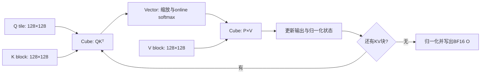
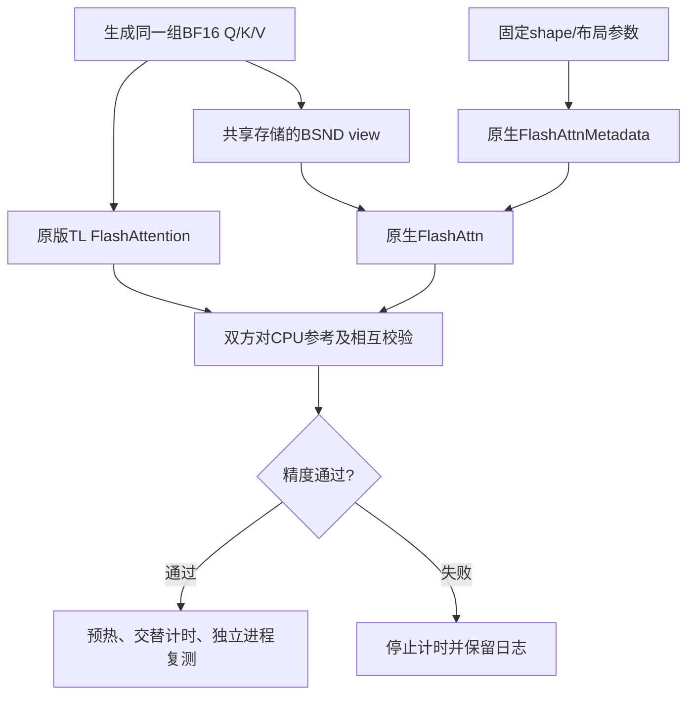

# 原版 MHA 算子对比测试设计与串讲

日期：2026-11-05。读者：负责环境准备、服务器执行、结果验收和汇报的测试同学。
建议串讲20分钟：规格3分钟、实现与边界5分钟、测试流程5分钟、指标与结果5分钟、问题讨论2分钟。

本文只使用固定上游的原版TileLang MHA与原生AscendC FlashAttn。
主测试规格为S=3584、BF16输入输出。当前文档不要求运行其他优化候选。

## 1. 先说明我们要回答什么

在相同输入、相同数学语义、相同输出类型下，比较两条完整调用路径：

1. 原版TileLang的延迟是多少，相对AscendC的AC/TL加速比是多少？
2. 使用当前28 AIC设备的Cube峰值，双方有效矩阵MFU是多少？
3. 结论在独立计时进程中是否保持一致，原始记录是否能够复核？

串讲开场可以直接说：

> 本次测的是单head注意力核心，输入是已经准备好的Q、K、V。我们先证明双方算对，
> 再在相同计时边界下比较延迟。固定shape的主结论使用metadata复用口径。

## 2. 唯一一组主测试规格

| 项目 | 本次取值 | 测试含义 |
|---|---|---|
| batch / heads | 1 / 1 | 单batch、单head |
| Q、K、V | [3584,128]，BF16 | 同一组设备张量供双方使用 |
| O | [3584,128]，BF16 | 双方内核直接输出BF16 |
| head_dim | 128 | 固定上游SIMD打包路径的约束 |
| scale | 1/sqrt(128) | 约0.08838835 |
| causal / dropout | False / 0 | 不使用三角mask，不做随机丢弃 |
| bias / LSE输出 | 无 / 不返回 | 没有额外attention bias或LSE结果 |
| TL分块 | Q128、KV128、stages3 | 使用固定上游默认配置 |
| 精度参考 | CPU FP32分块计算，最后舍入BF16 | 与双方相同输出类型对齐 |

与[原规格表](../MHA和mHC规格表)有两项已经确认的差异：

- 序列长度4096按7/8改为3584；D仍为128。
- 原表输出FP32已统一为BF16，使双方原生输出一致。

本次数学操作为：

```text
scores = Q @ K.T / sqrt(128)
P      = softmax(scores, dim=-1)
O      = P @ V
```

完整MHA层还包含Q/K/V投影、多head组织和输出投影；这些都不在本次计时范围。
当前规格表只有上述一组MHA场景。改变实现版本属于实验对照，不等于新增模型输入场景。

## 3. “原版”如何界定

| 对象 | 固定来源 | 使用方式 |
|---|---|---|
| TL数值源码 | tile-ai/tilelang，提交80364b3d9758854a9692cc0f14089025f54d3f3f | core.py::flash_attention_fwd |
| TL调用参数 | q_len=kv_len=3584，head_dim=128，out_dtype=bfloat16 | 其余tiling使用默认值；fast-math沿用上游示例 |
| AC数值源码 | cann/ops-transformer，提交ba5162411c919e15fbabb28298e8b420c11ad905 | FlashAttn、FlashAttnMetadata |
| AC构建范围 | flash_attn、flash_attn_metadata | 部分编译，安装到独立q4fa vendor |

“原版TL”指使用固定上游数值实现及默认分块，没有增加本项目的调优改造。
由于序列长度和输出dtype已按任务要求配置，不能说它与原example_mha的FP32输出调用字节级完全一致。
AC没有修改attention数值源码；构建环境处理与数值算法修改分开记录。

本地核对上游源码manifest及SHA256，记录AC源版本和已安装库SHA256。
源版本、库哈希与构建日志应一起保存；只看到某个库哈希不能单独证明它的构建来源。

## 4. 原版 FlashAttention 在做什么

原版TL按128行Q分块，每个逻辑Q任务遍历128行一块的K/V。
S3584对应28个Q tile、28个KV循环块。



它逐块维护每行最大值、指数和与输出累积，避免把完整S×S概率矩阵写回显存。
Cube负责两次矩阵乘；Vector负责softmax、缩放和输出处理，搬运单元在存储层级间传数据。
这解释了为什么MFU不是简单的“硬件忙碌百分比”：完整路径中还有必要的向量和搬运工作。

设备查询为28 AIC/56 AIV。28个逻辑Q任务与AIC数量相等是选择3584的动机，
但“逻辑block数等于核数”本身不证明具体物理映射、无等待或最优调度。
此外，4096→3584同时减少Q任务和KV循环，不能把所有收益单独归因于核数对齐。

## 5. 双侧调用、数据布局与metadata

TL直接使用Q/K/V的二维布局[3584,128]。
AC使用BSND布局[1,3584,1,128]；本场景通过view共享同一连续存储，不增加转置或数值转换。
PyTorch负责张量分配、view、调用、CPU参考与计时，没有用于补算attention或事后转换输出。



metadata是与shape/布局相关的调度描述，不是Q/K/V计算结果，也不是已缓存的输出。
有两种必须分开报告的调用范围：

| 口径 | metadata如何处理 | 适用解释 |
|---|---|---|
| cached，主口径 | 在计时前生成，固定shape重复使用 | 比较重复attention调用 |
| per_call，补充口径 | 每次AC调用前重新生成，计入时间 | 比较包含调度信息生成的完整请求 |

复用metadata时每次attention仍重新计算，输出和内部临时分配仍计时。
不能将per_call的额外成本解释为FlashAttn计算kernel本身慢了同样多。

## 6. 测试分层与通过条件

| 层次 | 检查内容 | 通过条件 |
|---|---|---|
| 环境/来源 | 设备、CANN、Python包、固定源码、q4fa库 | 来源与本次配置可追溯，依赖可用 |
| 单次冒烟 | 原版TL、AC各对CPU参考，再相互比较 | 形状、dtype、finite及误差门限全部通过 |
| 多种子精度 | seed=42/43/44，两种metadata模式 | 每项均通过，失败即停止 |
| API性能 | 各口径3个独立进程，双侧交替 | 数据完整，保留所有进程与轮次 |
| 设备profile | 两口径×两实现，各30次目标调用 | CSV有效，kernel名称与数量匹配 |

MHA验收门限：

```text
relative_L2 = ||O - reference||₂ / max(||reference||₂, 1e-30) <= 0.01
max_abs     = max(abs(O - reference)) <= 0.02
```

此外必须shape、dtype一致且全部finite。BF16实现间不要求逐位相同。
这些是当前算子测试的精度门限，不代表真实模型端到端精度认证。

## 7. 如何保证计时可比较

原版专用runner每个计时进程预热100次，执行10轮，每轮每侧100次。
双侧轮次顺序交替，避免某个实现始终先运行；cached/per_call按独立进程分别测试。

- **event_us**：NPU Event包围100次完整调用后除以100；作为主API指标。
- **wall_us**：主机计时覆盖调用和完成等待；用于交叉检查。
- **device Duration**：独立profile的kernel设备耗时；用于解释计算链。

event包括stream上实际调用链及可能的提交间隙；它不是纯指令执行时间。
不得将API与独立profile时间直接相减，声称获得精确主机开销。

| 计时内 | 计时外 |
|---|---|
| 每次attention数值计算 | 输入随机生成与CPU参考 |
| 每次输出/工作区分配 | 首次TL JIT与扩展编译 |
| per_call模式的metadata生成 | 预热 |
| 同步完成所需的Event边界 | cached模式首次metadata准备 |

每个进程先取10轮中位数，再取3个进程中位数作为汇总延迟。
AC/TL使用两个汇总延迟之比，同时保留逐进程配对比。不要以最快一次替代汇总。
本轮重复使用同一组输入地址且没有主动冷却L2，结果适用于该预热重复调用方式。

## 8. 加速比和MFU如何算

### 8.1 AC/TL加速比

```text
AC/TL = AscendC API event延迟 / TileLang API event延迟
```

大于1表示TL更快。1.076×表示AC用时为TL的1.076倍，
对应TL延迟降低约7.07%，不能直接说“延迟降低7.6%”。
只对相同shape、dtype和metadata口径计算这一比值。

### 8.2 算子级有效矩阵MFU

无mask attention包含QKᵀ和PV，两次矩阵乘，乘加按2 FLOPs：

```text
FLOPs = 4 * B * H * S² * D
      = 4 * 1 * 1 * 3584² * 128
      = 6,576,668,672

effective_TFLOPS = FLOPs / event_us / 1e6
MFU_percent     = effective_TFLOPS / 378 * 100
```

28 AIC设备使用Cube BF16峰值378 TFLOPS，来源为官方白皮书表3-1，配置保存在
[峰值文件](../operators/mfu/peaks/ascend950pr_28aic.json)。不使用32 AIC的432或Cube+Vector的425。
该峰值是额定理论值，不是本轮实测持续算力。
softmax等向量操作不计矩阵分子，但完整耗时计入分母；本指标不是完整模型MFU。

序列变为7/8后，矩阵计算量变为49/64，不能直接按7/8估算FLOPs。
本场景非因果，无需按下三角减半。MFU较低也不能直接解释为同样比例的设备空闲时间。

## 9. 已验证的原版结果

使用2026-11-03的独立原版复测，证据为1437c47:error.txt，
运行版本661c44965a68d07e78aab30a7aa07b10ce9df6bd。

| metadata口径 | TL API us | AC API us | AC/TL | TL矩阵MFU | AC矩阵MFU |
|---|---:|---:|---:|---:|---:|
| cached，主结论 | 24.681 | 26.558 | **1.076×** | **70.49%** | **65.51%** |
| per_call，补充 | 24.625 | 64.796 | 2.631× | 70.66% | 26.85% |

MFU由同轮[原始进程摘要](../reports/mha_plain3584/summary.json)的未舍入API中位数离线换算，
未重新运行设备。per_call分子的有效矩阵FLOPs不变，但分母含metadata生成，需注明这一额外边界。

cached逐进程AC/TL为1.0813、1.0749、1.0742，三进程均TL领先，wall方向一致。
48项输出检查通过。三个进程方向一致不等于已经给出统计显著性或所有设备上的保证。

设备profile的cached均值为TL 24.526us、AC 26.646us，设备AC/TL约1.086×，
每类30次；per_call的AC另有约38.269us metadata kernel。
这里的设备均值与上表API中位数是不同测量，不混成一个比值。

串讲结论建议表述：

> 在当前Ascend950PR的28 AIC、S3584/D128、BF16输入输出规格下，
> 固定上游原版TL对复用metadata的原生AC，完整API加速约1.076倍。
> 该轮原版TL有效矩阵MFU约70.49%，AC约65.51%。

## 10. 测试同学照着执行

### 10.1 已配置服务器：先冒烟，再完整执行

```bash
cd /home/z30086261/Q4
git pull --no-rebase
conda activate zwh
source /home/CANN/9.3.0.weekly.20260930/ascend-toolkit/set_env.sh
bash operators/mha/run_plain3584.sh smoke
```

冒烟通过后再执行：

```bash
bash operators/mha/run_plain3584.sh all
```

runner自动加载q4fa环境、检查/准备固定TL源码；物理设备默认4，进程内逻辑设备0。
若需换设备，在运行前显式设置ASCEND_RT_VISIBLE_DEVICES，并在记录中注明。
它不重建AC库或升级Python环境。若缺失依赖，应先按日志定位缺项。

也可以分别执行check、bench、profile模式。各次命令生成独立目录，
不要把不同目录的计数当作一个完整all结果。

### 10.2 汇总已完成的all结果

```bash
python operators/mha/collect_plain3584.py \
  --input results/mha-plain3584/20261103-151933-all-216035
```

复测后将示例路径换为runner打印的新目录。这个命令只读结果，不执行NPU计算。
正常all目录应有16份correctness文件、6份API摘要、4个profile目录、48项输出检查，
且每个目标设备kernel为30条。独立smoke目录不加到all目录计数。
汇总脚本打印计数，测试人员仍需对照预期逐项验收，不能只看命令退出码。

### 10.3 结果交付包

| 文件 | 测试/评审用途 |
|---|---|
| runner.log、各case的.log | 判断哪一步完成、失败与告警位置 |
| revision.txt、pip-freeze.txt、npu-smi.txt | 运行代码、软件环境和设备状态 |
| metadata.json | 实际shape/dtype、来源版本、库哈希和计时边界 |
| correctness.json | 每项精度、finite和shape/dtype验证 |
| timings.csv、summary.json | 逐轮延迟、单进程摘要、配对比 |
| profile下的kernel_details.csv | 设备kernel名称、次数、Duration |
| summary.txt | 汇总入口，便于粘贴至error.txt |

results/和third_party/被Git忽略。把summary贴到error.txt只能保存摘要；
复核稳定性还要保留原目录，必要时单独导出并提交相关小文件。
推送失败应保留结果目录，不能通过删除仓库并重克隆恢复未上传的采集数据。

## 11. 验收与常见问题

| 现象或疑问 | 测试人员应如何处理 |
|---|---|
| relative L2或max abs不通过 | 停止性能结论，保留具体输出项、seed、版本与日志 |
| 第一次运行出现编译 | 计时外首次JIT属于正常准备；等待完成后看精度与汇总 |
| 缺q4fa目录、固定源码或库 | 检查恢复说明和环境变量，先补缺项，不全量升级环境 |
| 稀疏算子converter导入告警 | 该告警此前未阻断本例；仍以本例精度、完整文件和实际结束状态为准 |
| profile-*.log提示CSV=0 | .log不是profile目录；检查实际目录中的CSV及目标kernel数 |
| event与wall差距变化 | 保留全部轮次与设备状态，核对调用/提交开销；不直接改结果 |
| 三个进程有胜有负 | 如实列出配对比和分布，不只引用聚合加速比 |
| 为什么不引用2.631×作主结论 | 它包含每次metadata生成；固定shape主体优先cached |
| 原版TL为什么也用PyTorch | 张量/调用/计时框架由PyTorch提供，attention数值计算由原版内核完成 |
| 28个Q tile是否证明每核一个且无尾部 | 不能；需要实际调度/时间轴证据 |
| 能否推广到其他S、head或模型 | 不能直接推广，需增加明确规格及独立精度/性能验证 |

重新运行不要求精确复现到某个小数位；重点是记录完整、口径一致、精度通过，
并结合多进程分布判断与已验证基线是否出现需要解释的变化。

## 12. 串讲时打开哪些文件

1. [原规格表](../MHA和mHC规格表)：说明S和dtype的任务调整。
2. [固定原版core.py](../operators/spec_v1/upstream_mha/core.py)：看FwdTiling和两次GEMM/online softmax。
3. [原版专用case](../operators/spec_v1/mha_plain3584.py)：看双方同输入、BSND view和metadata边界。
4. [公共bench](../operators/spec_v1/bench.py)：看validate、implementation_order和Event计时循环。
5. [原版runner](../operators/mha/run_plain3584.sh)：看smoke/check/bench/profile/all及产物数量。
6. [结果报告](../reports/mha_plain3584/report.md)：用cached三进程结果讲结论。

新测试同学完成串讲后应能回答：测什么、何为原版、为什么缓存metadata、
AC/TL分子分母是什么、MFU为什么用378、失败时保留什么，以及本次结果能推广到哪里。
